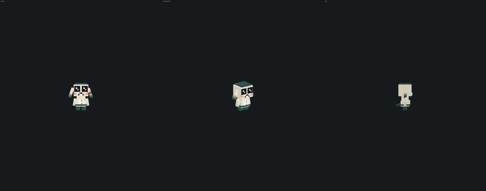

# Falsity 0.3.0

An original AI horror companion for **Minecraft Java 26.3**, built with **Fabric**.

Falsity begins as a small, harmless-looking companion: a plush creature with a
teal beanie, oversized glossy eyes and long drooping ears. It wanders, watches
you, and bonds with the first player who reaches out to it. What happens after
that is the rest of this project.

> **Status: Milestone 3 (interactive companion); 0.3.0 adds the personality
> system.** Falsity talks in ordinary chat (Groq AI with an offline fallback),
> follows orders, hands over items, answers questions about the world, builds,
> and remembers each player across sessions. Who it is comes from a text file
> you can edit, how it feels about you evolves as you play, and the horror
> progression changes how that personality comes out. It is still cute. It is
> still harmless. That is the point.



---

## What works today

| Feature | State |
| --- | --- |
| Fabric 26.3 mod loads | Yes — verified by the game-test server in CI |
| Original entity `falsity:falsity` | Yes |
| Original 3D model (11 parts, 16 boxes) | Yes — generated from a design file |
| Original texture (64×64, hand-painted by tooling) | Yes |
| Custom renderer, render state, model layer | Yes |
| Idle animation (breathing, ear sway, tail flick) | Yes — vanilla keyframe animation |
| Walk animation, head tracking, blinking | Yes — procedural, driven by the render state |
| Spawning | Spawn egg (creative *Spawn Eggs* tab) and `/falsity summon` |
| Bonding and petting | Yes — server-authoritative; held-use packet spam is suppressed |
| Natural chat and sit/follow/come/stay orders | Yes — address Falsity by name; recent follow-ups retain player-isolated context |
| Item requests | Yes — several items and amounts in one sentence ("a crafting table and 64 sticks"), exact items plus food, armour, weapons, tools, mining, building, lighting, transport, farming, redstone and survival categories; unknown names are reported, never substituted |
| Questions about the world | Yes — position, biome, dimension, time, weather, spawn, surroundings, nearest structure, nearby ores and caves, answered from the game itself, never guessed by the model |
| Building | Yes — bounded plans, confirmation, materials, progressive placement, progress and cancellation |
| Groq conversations | Yes — async, server-side, remembers the last few exchanges; orders work without it; a message sent during the cooldown waits its turn instead of being dropped |
| Groq diagnostics | Yes — `/falsity ai status` and `/falsity ai test` say whether Groq really answers and, if not, why and what to do |
| Offline fallback personality | Yes — Falsity always answers, even with no key or no network, and answers what was said rather than repeating one line |
| Persistent per-player memory | Yes — `falsity-memory/<uuid>.json`, isolated per player |
| Configurable personality | Yes — `config/falsity/personality.txt`, created with a default, picked up when saved, safe fallback when empty or missing (see [docs/PERSONALITY.md](docs/PERSONALITY.md)) |
| Layered prompt | Yes — rules, personality, horror stage, relationship, memory, world, then the message; each layer bounded |
| Evolving personality (9 traits) | Yes — persists per player, drifts with interactions, and is told to the model along with absences and how the player has treated Falsity |
| Speaking first | Yes — now and then, to its owner, with Groq only; `chat.speaksFirst` switches it off |
| Horror progression (Innocence → Strange) | Yes — architecture + staring + unsettling lines; capped, harmless. Every stage now has a voice of its own; the three beyond Strange are ready but stay closed until the cap is raised |
| Configuration file | Yes — `config/falsity.json` (see `docs/falsity.example.json`) |
| Transformation, stalking, jumpscares | **Not implemented** — see [ROADMAP](docs/ROADMAP.md) |

---

## Requirements

- **Java 25** to build and run. Minecraft 26.3 requires it, and so does Fabric
  Loom 1.19.
- **Gradle 9.8.2** — supplied by the wrapper, no local install needed.
- **Minecraft 26.3** with **Fabric Loader 0.20.1** and **Fabric API 0.165.2+26.3**
  to play the built jar.
- **A Groq API key (optional).** Without one, Falsity uses its offline lines.
  See [Groq setup](#groq-setup-optional) below.

All versions are declared in [`gradle.properties`](gradle.properties) and were
checked against <https://fabricmc.net/develop> on 2026-11-10.

## Building

```bash
./gradlew build
```

The jar lands in `build/libs/`. The same task compiles both source sets, runs the
unit tests and runs the server-side game tests: a real headless server loads the
mod, spawns Falsity, ticks it, bonds it to a player, exercises the sit/follow
orders, measures it walking towards its owner, and verifies memory, personality,
horror and offline conversations. If any of that fails, the build fails.

At the time of writing that is 663 unit tests and 55 game tests. Two of the unit
tests talk to the real Groq service and only run when a key is supplied; without
one they are reported as skipped, not as passed (see [docs/GROQ.md](docs/GROQ.md)).

How the verification is reported, and what it does and does not prove, is
described in [docs/DEVELOPMENT.md](docs/DEVELOPMENT.md).

## Running it

```bash
./gradlew runClient   # development client
./gradlew runServer   # development server
```

In game, either

- take the **Falsity Spawn Egg** from the *Spawn Eggs* creative tab, or
- run `/falsity summon` (permission level 2), or
- run `/summon falsity:falsity`.

Then:

- **Chat naturally** — say `Falsity, come here`, `Falsity?`, `Falcity, follow me`, or continue a recent conversation without repeating its name. Replies are private to the addressing player; ordinary multiplayer chat is ignored, and so is a follow-up that calls another player by name (`Alex, come here`).
- **Give it a personality** — edit `config/falsity/personality.txt` and save. The next thing Falsity says uses it. See [docs/PERSONALITY.md](docs/PERSONALITY.md).
- **Let it talk first** — with Groq set up, Falsity occasionally says something of its own when you are close and nobody has been talking: at most once every ten minutes, and never more than twice running if you do nothing in return. `chat.speaksFirst` switches it off.
- **Request supplies** — for example `Falsity, give me food`, `I need a full set of armour`, `give me a crafting table and 64 sticks`, or `give me diamond tools`. Every item named is handed over in the amount asked for; a name Falsity does not know is said so while the rest still arrives. Who may ask, how many of one item (`items.maxPerRequest`), how many kinds at once (`items.maxTypesPerRequest`) and when a confirmation is asked for (`items.confirmAboveCount`) are server settings.
- **Ask about the world** — `where am I?`, `what biome is this?`, `is it raining?`, `where is the nearest village?`, `any diamonds nearby?`. The answer comes from the game, with a direction, a distance and coordinates, not from the language model. Looking for structures, ores and caves follows `world.locatePermission` (the owner by default) and a short cooldown; ore and cave scans only read chunks that are already loaded. Coordinates are left out when `world.shareCoordinates` is off or the world's `reducedDebugInfo` game rule is on.
- **Request a build** — for example `Falsity, build a small wooden house`. Falsity describes plans that require confirmation, validates the area and materials, places progressively, and accepts `stop building`.
- **Give movement orders** — `come here`, `follow me`, `stay here`, `sit down`, `stand up`, and `stop following me` all work through normal chat.
- **Right-click Falsity** — the first player to do so bonds with it.
- **Shift + right-click** — tell it to stay, or to follow again.
- **Right-click while bonded** — pet it; it heals slightly and plays its greeting.
- **`/falsity talk <message>`** — talk to Falsity (must be within 16 blocks).
  Replies come from Groq when configured, otherwise from offline lines.
- **`/falsity ai status`** and **`/falsity ai test`** (op) — whether Groq is
  really answering, and if not, why.
- **`/falsity reload`** (op) — apply an edited `config/falsity.json` and
  personality file without a restart.
- **`/falsity memory`** — see what Falsity remembers about you.
- **`/falsity personality`** — see how Falsity feels about you, which
  personality text is in use and which voice its horror stage gives it.
- **`/falsity personality reload`** (op) — read `config/falsity/personality.txt`
  again and report what was loaded.
- **`/falsity horror`** — see Falsity's current stage towards you.
- **`/falsity memory clear <player>`** (op) — wipe a player's memory.
- **`/falsity horror set <player> <0-4>`** (op) — set a horror stage (testing).

Try saying `remember my favourite block is diamonds`, or just `my base is by
the river`, then talk again later: Falsity will refer back to it.

## Groq setup (optional)

Falsity talks through [Groq](https://console.groq.com)'s OpenAI-compatible
API. It works without a key (offline lines, and orders, item requests and
world questions are handled by the server itself), but with one it holds real
conversations.

1. Create a free API key at <https://console.groq.com/keys>.
2. Put it in **one** of these places (first match wins):
   - the `GROQ_API_KEY` environment variable (recommended for servers), or
   - a file named exactly `secrets.json` in the game directory or in `config/`
     — copy `docs/secrets.example.json` and replace the placeholder (this file
     is git-ignored; never commit it), or
   - the `groq.apiKey` field in `config/falsity.json` (ships empty; do not
     commit a real key).
3. In game, run **`/falsity ai test`**. It sends one request and answers either
   `Groq works. It answered "..."` or the reason it failed and what to do.
   `/falsity ai status` shows where the key was found, the model, and the last
   success and failure.
4. Optionally change `groq.model` in `config/falsity.json`. The default is
   `openai/gpt-oss-20b`. Groq retires models without much notice; when that
   happens the test says `MODEL_UNAVAILABLE`.

If Falsity only gives short scripted answers, Groq is not answering: every
failed request is logged as a warning with its cause, and
**[docs/GROQ.md](docs/GROQ.md)** lists each cause (no key found, key rejected,
request refused, model gone, wrong address, rate limit, timeout, no network)
with its fix.

The key is only ever used server-side, as a `Bearer` header to Groq. It is
never logged, never sent to clients, and never written back to disk.

**Offline mode:** set `groq.enabled` to `false` in `config/falsity.json`, or
simply leave the key empty. Falsity answers from its scripted personality
instead. Nothing breaks; the game never waits on the network.

## How memory works

Each player gets one file: `<gameDir>/falsity-memory/<uuid>.json`. It holds
first meeting, conversation and pet counts, durable facts (names,
preferences, things you asked it to remember), recent interactions, a local
summary, the personality profile and the horror stage. Files are written
atomically; a corrupt file is discarded with a warning instead of crashing
the server. Only relevant memories (keyword-matched to your message) are
sent to Groq — never the whole history. Facts and recent notes are capped
(see `memory` in the config), so memory cannot grow without bound.

The same file also keeps how long you were last away and whether your recent
messages were kind or harsh, which is what lets Falsity react to how it is
treated. The personality text is not in it: that is one file for the whole
server, `config/falsity/personality.txt`, and changing it never touches a
player's memory, personality values or horror stage.

## Design notes

Falsity's model and texture are both generated from a single design file,
[`tools/model/falsity_model.json`](tools/model/falsity_model.json):

```bash
python3 -m pip install pillow
python3 tools/generate_assets.py            # regenerate model geometry + textures
python3 tools/generate_assets.py --preview  # also render a preview sheet
python3 tools/generate_assets.py --check    # verify nothing is stale (used by CI)
python3 tools/validate_assets.py            # static resource checks
```

Because one tool computes the UV layout, paints the texture and writes the Java
geometry, the model and its art cannot drift apart. The preview renderer is a
small z-buffered rasteriser used to review the creature without launching the
game — it is QA tooling, not part of the mod.

## Documentation

- [docs/INSTALL.md](docs/INSTALL.md) — building the jar and installing it
- [docs/GROQ.md](docs/GROQ.md) — Groq setup, diagnostics and every failure with its fix
- [docs/PERSONALITY.md](docs/PERSONALITY.md) — the personality file, the prompt layers, the horror voices and speaking first
- [docs/ARCHITECTURE.md](docs/ARCHITECTURE.md) — how the code is organised and why
- [docs/DEVELOPMENT.md](docs/DEVELOPMENT.md) — environment setup, commands, tooling
- [docs/ROADMAP.md](docs/ROADMAP.md) — milestones and what is deliberately not built yet
- [docs/falsity.example.json](docs/falsity.example.json) — annotated config example
- [docs/secrets.example.json](docs/secrets.example.json) — secrets file template

## Licence

MIT — see [LICENSE](LICENSE). All art, geometry and code in this repository is
original to this project.
